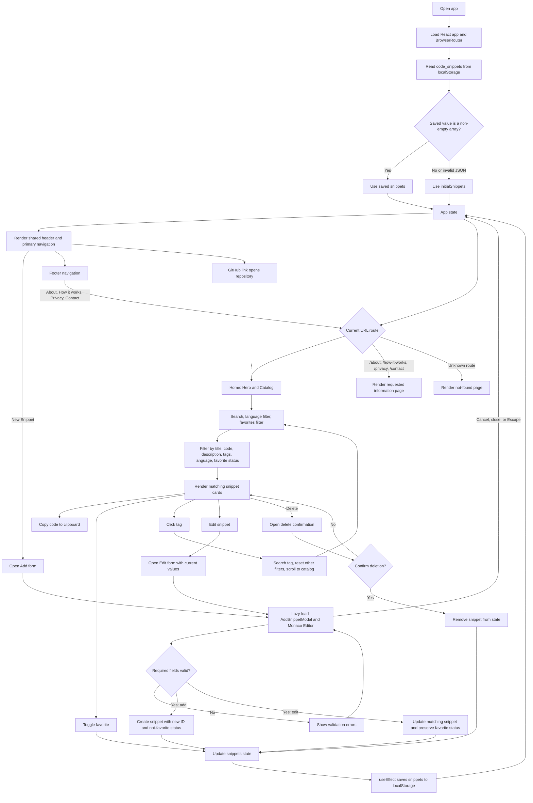

# Code Snippet Hub

## პროექტის ინფორმაცია

| ველი | ინფორმაცია |
| --- | --- |
| პროგრამა | Front-end პროგრამირება |
| მოდული | პრაქტიკული პროექტი (06.1.1.9) |
| კრედიტი | 4 |
| სტუდენტი | Giorgi Kavtaradze |
| შეფასების თარიღი | 6 ნოემბერი, 2026 |
| GitHub | https://github.com/gvxhrgi/codesnippet-hub |

**პროექტის მიზანი:** შეიქმნას რესპონსიული ვებაპლიკაცია, სადაც მომხმარებელს შეუძლია კოდის ფრაგმენტების შენახვა, მოძებნა, გაფილტვრა, რჩეულებში დამატება, რედაქტირება და კოპირება.

## ფუნქციონალი

- ახალი ფრაგმენტის დამატება და არსებული ფრაგმენტის რედაქტირება.
- კოდის შეყვანა Monaco Editor-ში; ფორმის ველების ვალიდაცია.
- ძიება სათაურით, აღწერით, კოდითა და ტეგებით.
- ფილტრაცია პროგრამირების ენითა და რჩეულებით.
- ფრაგმენტის რჩეულებში დამატება, წაშლის დადასტურება და კოდის კოპირება.
- მონაცემების შენახვა ბრაუზერის `localStorage`-ში.
- განლაგება CSS Grid/Flexbox-ით და ეკრანის ზომაზე მორგებული breakpoint-ებით.

## ტექნოლოგიები და რესურსები

| კატეგორია | გამოყენება |
| --- | --- |
| HTML5 / JSX | React კომპონენტებში სემანტიკური UI სტრუქტურა |
| CSS3 | ვიზუალური სტილი, Flexbox, Grid და რესპონსიული breakpoint-ები |
| JavaScript (ES modules) | აპლიკაციის მდგომარეობა, ძიება/ფილტრაცია და მომხმარებლის მოქმედებები |
| React 19 | კომპონენტებზე დაფუძნებული ინტერფეისი |
| Vite | ლოკალური დეველოპმენტის სერვერი და production build |
| Monaco Editor | კოდის შეყვანა და ენის შესაბამისი რედაქტორი |
| lucide-react | ინტერფეისის ხატულები |
| Git / GitHub | ცვლილებების ვერსიების კონტროლი და რეპოზიტორიუმი |
| ბრაუზერი, Node.js, npm, ტექსტური რედაქტორი | გაშვება, შემოწმება და კოდზე მუშაობა |

დიზაინისთვის გამოყენებულია პროექტში არსებული ვიზუალური აქტივები. საჭიროების შემთხვევაში, ინტერნეტით ხელმისაწვდომია ოფიციალური დოკუმენტაცია React-ის, Vite-ის, MDN-ისა და Monaco Editor-ისთვის.

## სამუშაო გეგმა

სამუშაო გეგმა მოიცავს **2026 წლის 31 ოქტომბრიდან 5 ნოემბრამდე** პერიოდს. პროექტის დასრულება დაგეგმილია 5 ნოემბერს, ხოლო შეფასების თარიღია 6 ნოემბერი. ქვემოთ მოცემული განრიგი არის სამუშაო გეგმა და არა შესრულებული სამუშაოს ფაქტობრივი ჟურნალი.

| ეტაპი | სავარაუდო დრო | სამუშაო და შედეგი |
| --- | --- | --- |
| 1. მოთხოვნების ანალიზი და დაგეგმვა | 31 ოქტომბერი | ფუნქციების ჩამონათვალი, ეტაპები, რესურსები და რისკები |
| 2. სტრუქტურა და ვიზუალური განლაგება | 1 ნოემბერი | React კომპონენტები, ძირითადი გვერდი და საწყისი სტილები |
| 3. ფუნქციონალის შექმნა | 2–3 ნოემბერი | CRUD მოქმედებები, ძიება, ფილტრაცია და რჩეულები |
| 4. რესპონსიულობა და შემოწმება | 4 ნოემბერი | მოწყობილობებზე შემოწმება, lint და production build |
| 5. დოკუმენტაცია და საბოლოო მომზადება | 5 ნოემბერი | README-ის დასრულება, GitHub-ის საბოლოო ვერსიის შემოწმება და პრეზენტაციის მომზადება |

### რისკები და მართვა

| რისკი | გავლენა | პრევენცია / რეაგირება |
| --- | --- | --- |
| `localStorage`-ში არასწორი JSON | მონაცემების ჩატვირთვის შეცდომა | ჩატვირთვისას JSON-ის დამუშავება `try/catch`-ით და საწყის მონაცემებზე დაბრუნება |
| ცარიელი ან არასრული ფორმა | არასწორი ჩანაწერი | სავალდებულო ველების ვალიდაცია შენახვამდე |
| მცირე ეკრანზე ელემენტების გადატვირთვა | გამოყენებადობის გაუარესება | CSS breakpoint-ები და მობილურ viewport-ზე ხელით შემოწმება |
| პაკეტის ან build-ის შეცდომა | აპის გაშვების შეფერხება | `npm run lint` და `npm run build`; შეცდომის დაფიქსირება და განმეორებითი შემოწმება |
| ბრაუზერის მონაცემების დაკარგვა/სხვა მოწყობილობაზე მიუწვდომლობა | ფრაგმენტების დაკარგვა ან სინქრონიზაციის არქონა | განმარტებულია შეზღუდვა: მონაცემები ლოკალურია; მნიშვნელოვანი ფრაგმენტების სარეზერვო ასლი შეინახეთ |

### პასუხისმგებლობები და კომუნიკაცია

პროექტი წარმოდგენილია როგორც ინდივიდუალური ნამუშევარი. სტუდენტი პასუხისმგებელია მოთხოვნების გააზრებაზე, დაგეგმვაზე, კოდის შექმნასა და შემოწმებაზე, Git commit-ებზე, დოკუმენტაციასა და პრეზენტაციაზე. მასწავლებლის როლია დავალების პირობების განმარტება და შეფასება; უკუკავშირისა და კონსულტაციის ფაქტობრივი ჩანაწერები დაამატეთ მხოლოდ იმ შემთხვევაში, თუ ასეთი კომუნიკაცია რეალურად შედგა.

## არქიტექტურა და მუშაობის სქემა

`src/main.jsx` ქმნის React აპს და ჩართავს URL-ებზე დაფუძნებულ ნავიგაციას. `src/App.jsx` მართავს საერთო მდგომარეობას, მარშრუტებს, ფილტრაციასა და მონაცემების შენახვას. Navbar და Footer ყველა მარშრუტზე საერთოა; მთავარი გვერდი აჩვენებს Hero-სა და კატალოგს, ხოლო ინფორმაციული გვერდები ცალკე მარშრუტებზეა. Add/Edit ფორმა და Monaco Editor საჭიროებისას იტვირთება. საწყისი ჩანაწერები ინახება `src/data/initialSnippets.js`-ში; ენის შესაბამისობას ეხმარება `src/utils/monacoLanguages.js`.



## მონაცემთა მოდელი

თითოეული ფრაგმენტი არის ობიექტი შემდეგი ველებით:

```js
{
  id: "unique-id",
  title: "filename-or-title",
  language: "javascript",
  description: "Optional explanation",
  code: "console.log('Hello');",
  tags: ["example", "javascript"],
  isFavorite: false
}
```

## გაშვება და შემოწმება

საჭიროა Node.js და npm.

```bash
npm install
npm run dev
```

შემოწმებისა და production build-ის ბრძანებები:

```bash
npm run lint
npm run build
npm run preview
```

**შემოწმების ჩანაწერი:** 2026 წლის 3 ნოემბერს `npm run lint` და `npm run build` წარმატებით დასრულდა. წარდგენამდე ხელახლა გაუშვით ორივე ბრძანება საბოლოო commit-ის მდგომარეობაზე.

| შემოწმება | შედეგი | თარიღი |
| --- | --- | --- |
| ESLint (`npm run lint`) | წარმატებით დასრულდა | 3 ნოემბერი, 2026 |
| Production build (`npm run build`) | წარმატებით დასრულდა | 3 ნოემბერი, 2026 |
| Chrome სხვადასხვა მოწყობილობაზე | მომხმარებლის ინფორმაციით, ყოველი მნიშვნელოვანი განახლების შემდეგ შემოწმდა და ყველაფერი მუშაობდა | ყოველი მნიშვნელოვანი განახლების შემდეგ |

**ცნობილი შეზღუდვა:** მონაცემები ინახება მხოლოდ მიმდინარე ბრაუზერში და ავტომატურად არ სინქრონდება სხვა მოწყობილობასთან ან მომხმარებლებს შორის.

## Git / GitHub

ცვლილებები მართეთ მცირე, თემატური commit-ებით, მაგალითად: `Add snippet search`, `Make catalog responsive`, `Document project`. საბოლოო წარდგენამდე გადაამოწმეთ `git status`, შექმენით commit-ები და ატვირთეთ ისინი GitHub-ზე (`git push`). რეპოზიტორიუმი: https://github.com/gvxhrgi/codesnippet-hub

## შეფასების მტკიცებულებები

- **დაგეგმვა:** ამ README-ის სამუშაო გეგმა და რისკების ცხრილი; შეასწორეთ ფაქტობრივად შესრულებული ინფორმაციით.
- **რესურსები და მეთოდები:** ტექნოლოგიების ცხრილი და `package.json`.
- **არქიტექტურა/მარკირება:** `src/App.jsx`, `src/components/`.
- **რესპონსიულობა:** `src/components/Catalog.css`, `src/components/Hero.css`, `src/components/Navbar.css`.
- **ფუნქციონალი:** `src/App.jsx`, `src/components/Catalog.jsx`, `src/components/AddSnippetModal.jsx`, `src/components/SnippetCard.jsx`.
- **ვერსიების კონტროლი:** Git-ის commit-ების ისტორია და GitHub რეპოზიტორია.
- **შემოწმება:** lint/build-ის შედეგები და თქვენ მიერ შესრულებული viewport ტესტების ჩანაწერი.
- **ანგარიში/პრეზენტაცია:** ეს README და [პრეზენტაციის მონახაზი](docs/presentation.md).

## წარდგენის წინ

- შეასწორეთ გეგმიური ეტაპების თარიღები, თუ ისინი რეალურ შესრულებას არ ემთხვევა.
- საჭიროების შემთხვევაში, წარდგენამდე კიდევ ერთხელ შეამოწმეთ აპი იმ მოწყობილობებზე, რომლებსაც დემოზე გამოიყენებთ.
- დარწმუნდით, რომ ყველა საბოლოო ცვლილება დაკომიტებული და GitHub-ზე ატვირთულია.
- მოამზადეთ დემო და გამოიყენეთ `docs/presentation.md` სლაიდების მოსამზადებლად.
