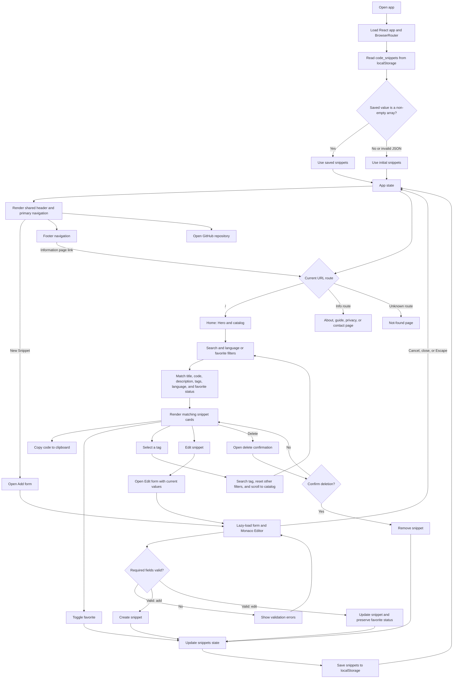

# CodeSnippet Hub

CodeSnippet Hub არის რესპონსიული ბრაუზერზე დაფუძნებული ბიბლიოთეკა სადაც მომხმარებელს შეუძლია შეინახოს, გააზიაროს, მოძებნოს, ფავორიტებში დაამატოს კოდი.

**Repository:** [github.com/gvxhrgi/codesnippet-hub](https://github.com/gvxhrgi/codesnippet-hub)
**Google Slides:** [Link](https://docs.google.com/presentation/d/1L0SMdSlLzon-DDjLruLSUrXK_jV8Iq6FYiA2sz3Q86A/edit?slide=id.p1#slide=id.p1)

## Features

- შექმენით და დაარედაქტირეთ ჩანაწერები მოქნილი ინტერფეისით და Syntax Highlight-ით.
- მოძებნეთ ჩანაწერები სათაურის, კოდის, აღწერილობის და ტეგების მიხედვით.
- გაფილტრეთ ენების და ფავორიტების მიხედვით.
- დაამატეთ ჩანაწერები ფავორიტებში, შემდეგ ერთი დაჭერით დააკოპირეთ ის.
- დამადასტურებელი Modal წაშლის წინ.
- შეინახე ჩანაწერები ბიბლიოთეკაში `localStorage` დახმარებით.
- რესპონსიული ვებგვერდი Desktop, Tablet და Mobile ეკრანებისთვის.
- Monaco Editor ოპტიმიზაციის გამო ირთვება მხოლოდ მაშინ როდესაც ამატებთ ან არედაქტირებთ ჩანაწერს

## Getting Started

### Requirements

- Node.js
- npm

### Install and run

```bash
npm ci
npm run dev
```

### Available commands

| Command | Description |
| --- | --- |
| `npm run dev` | Start the local development server |
| `npm run lint` | Run ESLint |
| `npm run build` | Create the optimized production build in `dist/` |
| `npm run preview` | Preview the production build locally |

## Pages

| Path | Description |
| --- | --- |
| `/` | Snippet catalog and search |
| `/about` | Project overview |
| `/how-it-works` | Feature guide |
| `/privacy` | Browser storage and privacy details |
| `/contact` | Link to the GitHub repository |

ვებ-გვერდი ასევე აღიქვამს საზიებოში არასწორად ჩაწერილ გვერდის მისამართს და აბრუნებს Page Not Found გვერდს.

## How It Works



## Project Structure

```text
src/
  components/   Page, catalog, card, navigation, and modal components
  data/         Initial example snippets
  utils/        Monaco language mapping
  App.jsx       App routes, state, filtering, and persistence
  main.jsx      React entry point and router setup
public/         Static assets served directly
```
