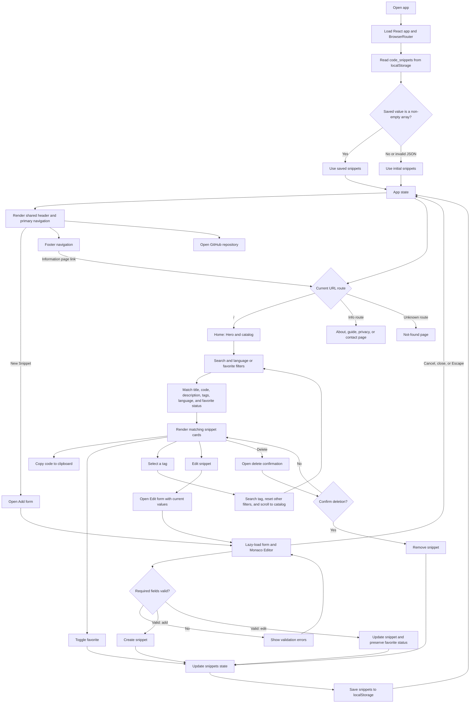

# CodeSnippet Hub

CodeSnippet Hub is a responsive browser-based library for saving, finding, and reusing code snippets. Organize entries with a language, description, and tags; search the catalog; and keep useful snippets marked as favorites.

**Repository:** [github.com/gvxhrgi/codesnippet-hub](https://github.com/gvxhrgi/codesnippet-hub)

## Features

- Create and edit snippets with a Monaco code editor and required-field validation.
- Search snippet titles, code, descriptions, and tags.
- Filter by programming language and favorite status.
- Add snippets to favorites, jump to a tag search, and copy code to the clipboard.
- Confirm before deleting a snippet.
- Save the snippet library in the current browser with `localStorage`.
- Responsive layouts for desktop, tablet, and mobile screens.
- Separate About, How it works, Privacy, and Contact pages.
- Load the Monaco editor only when the Add/Edit form is opened.

## Getting Started

### Requirements

- Node.js compatible with the installed Vite version
- npm

### Install and run

```bash
npm ci
npm run dev
```

Vite prints the local development URL after the server starts.

### Available commands

| Command | Description |
| --- | --- |
| `npm run dev` | Start the local development server |
| `npm run lint` | Run ESLint |
| `npm run build` | Create the optimized production build in `dist/` |
| `npm run preview` | Preview the production build locally |

## Pages

| Path | Description |
| --- | --- |
| `/` | Snippet catalog and search |
| `/about` | Project overview |
| `/how-it-works` | Feature guide |
| `/privacy` | Browser storage and privacy details |
| `/contact` | Link to the GitHub repository |

The app also displays a not-found page for unrecognized paths.

## How It Works

The app loads a non-empty snippet array from `localStorage`; if there is no usable saved array, it starts with the examples in `src/data/initialSnippets.js`. Snippet changes and favorite toggles update app state and are then written to `localStorage`. Add/Edit opens a lazily loaded form and Monaco Editor. Search and filters run against the current snippet list.



## Data and Privacy

There is no account system or application backend. Snippets are stored under the `code_snippets` key in the browser’s `localStorage` and are not synchronized between browsers or devices. Clearing the site’s browser storage removes the saved library. Do not store passwords, API keys, or other secrets in snippets.

The Monaco editor loads its editor resources when opened and may require network access. The catalog itself displays saved code without initializing Monaco.

## Deployment

Build the static site with `npm run build` and deploy the contents of `dist/` to a static hosting provider. Because the app uses client-side routes, configure the host to serve `index.html` for paths such as `/about` and `/privacy`. If deploying under a URL subpath, configure Vite’s `base` option for that path before building.

## Project Structure

```text
src/
  components/   Page, catalog, card, navigation, and modal components
  data/         Initial example snippets
  utils/        Monaco language mapping
  App.jsx       App routes, state, filtering, and persistence
  main.jsx      React entry point and router setup
public/         Static assets served directly
```
