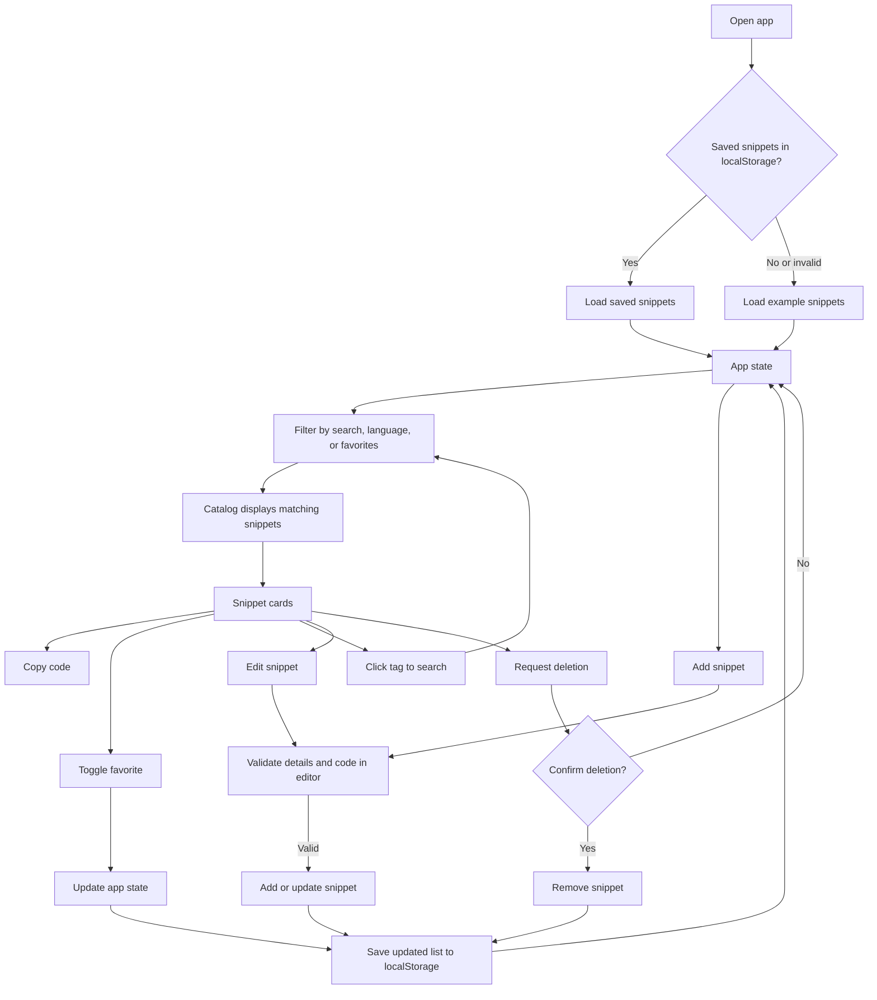

# Code Snippet Hub

A React app for collecting, searching, filtering, favoriting, editing, and copying code snippets. Snippets are saved in browser `localStorage` and restored the next time the app opens.

## How It Works



The app starts with saved browser data when available, otherwise it uses the examples in `src/data/initialSnippets.js`. Add and edit share a validated form with a Monaco code editor. Any change to the snippet list is written back to `localStorage`.

## Run Locally

```bash
npm install
npm run dev
```

To create a production build, run `npm run build`.
